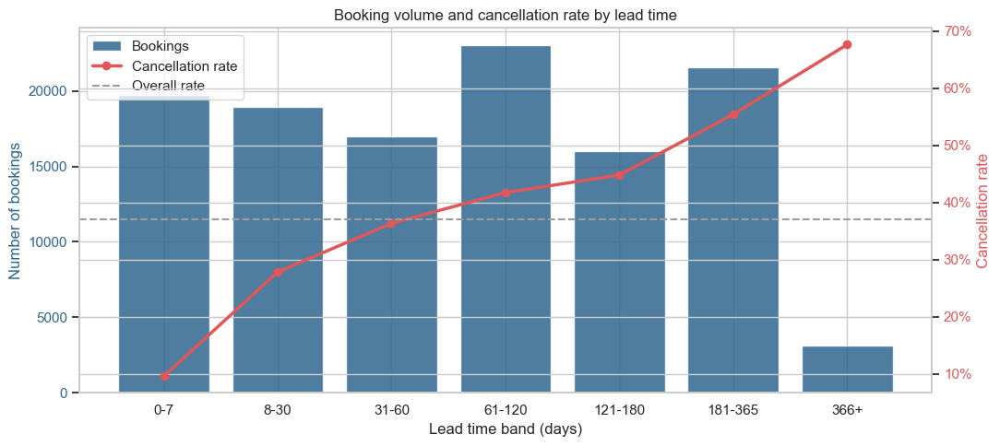
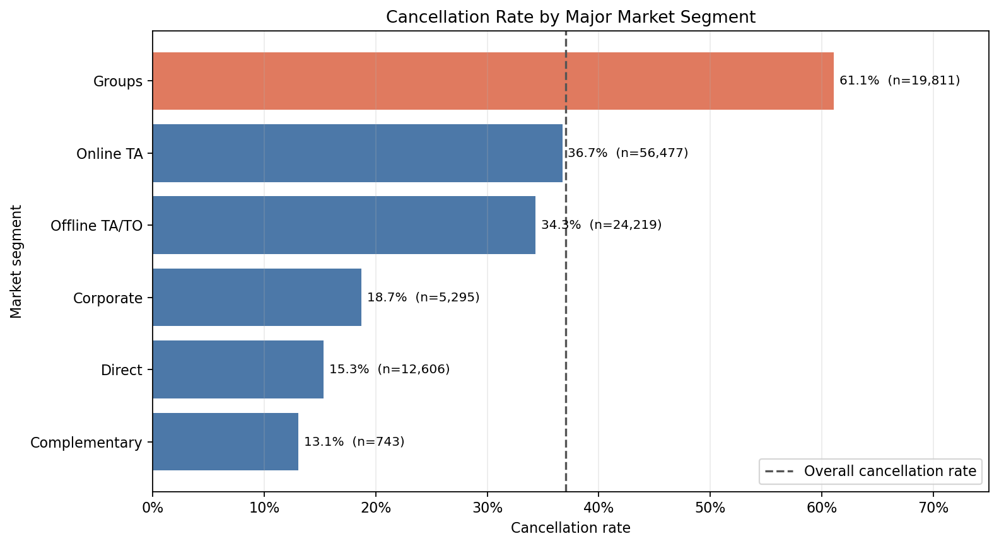
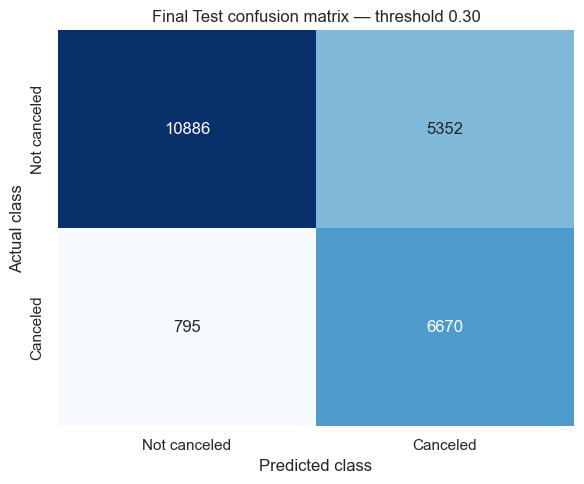
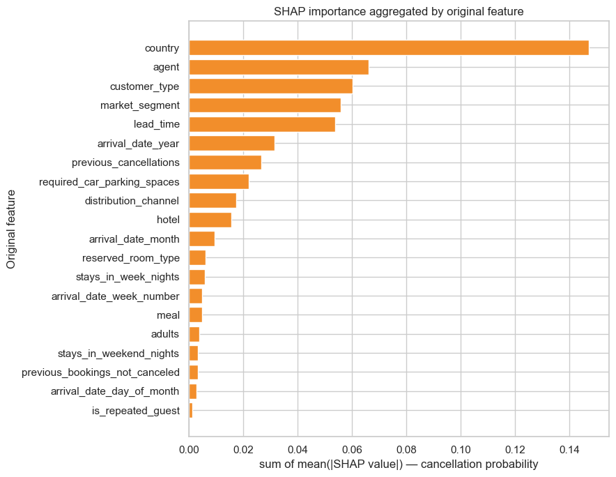

# Hotel Booking Cancellation Analysis

ホテル予約データを用いて、キャンセル傾向の把握、予約登録直後の情報によるキャンセル予測、SHAPによる予測根拠の確認、施策提案までを一貫して行ったポートフォリオです。

## ダッシュボード

Streamlitアプリは次の4ページで構成しています。

| ページ | 内容 |
|---|---|
| Overview | 全体KPI、市場セグメント・ホテル種別・Lead Time別のキャンセル傾向 |
| EDA | 国別、リピーター別、ADRとLead Timeの関係 |
| Prediction | 保存済みRandom Forest Pipelineによる予約1件ごとのキャンセル確率と閾値0.30の判定 |
| Recommendations | 長期予約、Groups、高リスク予約への3つの施策案 |

CSVはリポジトリに含めません。ローカルCSVがない場合、アプリはTidyTuesdayが公開する同一データを実行時に取得します。元データはAntónio, de Almeida, and Nunes (2019) によるCC BY 4.0のデータです。出典を保持し、元CSVそのものは本リポジトリから再配布していません。

## 分析の目的

ホテル予約のキャンセルは客室在庫や売上計画に影響します。本分析では、キャンセル率が高い予約の傾向、予約登録直後に利用可能な情報だけでの予測可能性、予測結果を施策にどう活用できるかを検討しました。

## 使用データ

- データセット: Hotel Booking Demand（119,390件、32列）
- 目的変数: `is_canceled`（1: キャンセル、0: 非キャンセル）
- 一次出典: [António, de Almeida, and Nunes (2019)](https://doi.org/10.1016/j.dib.2018.11.126)（CC BY 4.0）
- 公開取得先: [TidyTuesday: Hotels](https://github.com/rfordatascience/tidytuesday/tree/main/data/2020/2020-02-11)

## 主な結果

| 項目 | 結果 |
|---|---:|
| 全体キャンセル率 | 37.0% |
| Lead Time 61日以上のキャンセル率 | 48.4% |
| `market_segment = Groups` のキャンセル率 | 61.1% |
| Final Test ROC-AUC | 0.8622 |
| Final Test Recall（閾値0.30） | 0.8935 |
| Final Test Precision（閾値0.30） | 0.5548 |





## 機械学習

予測時点は「予約登録直後」と定義し、結果確定後に得られる情報や利用可能性が不明な情報は除外しました。`reservation_status`、`reservation_status_date`、`assigned_room_type`、`booking_changes`、`days_in_waiting_list`、`deposit_type`、`adr`、`total_of_special_requests`、`company`は使用していません。

推定予約日を基準に時系列順でTrain 60%・Validation 20%・Final Test 20%へ分割しました。欠損値補完、country上位17か国・agent上位10社の選定、One-Hot EncodingはすべてPipeline内で学習データから行っています。

```python
RandomForestClassifier(
    n_estimators=200,
    max_depth=18,
    min_samples_leaf=4,
    min_samples_split=8,
    random_state=42,
    n_jobs=-1,
)
```

ValidationでF1-scoreが最大となった0.30を閾値として採用し、設定確定後にTrainとValidationを結合して再学習しました。Final Testはモデルや閾値の選択には利用していません。

| Final Test指標 | 値 |
|---|---:|
| Accuracy | 0.7407 |
| Precision | 0.5548 |
| Recall | 0.8935 |
| F1-score | 0.6846 |
| ROC-AUC | 0.8622 |
| PR-AUC | 0.7362 |





SHAP値やセグメント別の傾向はモデル上の寄与・関連であり、キャンセル原因を証明するものではありません。

## 提案する施策

1. **長期予約への自動フォロー**: Lead Time 61日以上を対象に、予約確認と宿泊前リマインドを送る。
2. **Groups予約の内容確認**: 人数、部屋数、日程、支払条件、キャンセル期限を段階的に確認する。`Groups`は実際の団体人数を直接表す区分ではない点に注意する。
3. **高リスク予約への優先対応**: 予測確率0.30以上を低コストな自動対応の対象とし、個別対応は確率上位層へ絞る。

施策の効果は未検証です。実務では対象群と比較群を無作為割付するA/Bテストで、キャンセル率・施策コスト・利益への影響を確認します。ROI感度分析は補足Notebookとして残していますが、公開ダッシュボードの機能には含めていません。

## 技術スタック

Python / pandas / NumPy / Matplotlib / Seaborn / scikit-learn / SHAP / Streamlit / Plotly / PostgreSQL / Docker Compose / JupyterLab

## 構成

```text
app.py                    # Streamlitダッシュボード
data/                     # ローカルCSV配置先（Git管理外）
models/                   # 保存済みPipeline
notebooks/                # EDA、予測、SHAP、施策提案、ROI感度分析
sql/                      # PostgreSQL用の集計SQL
src/                      # 前処理器・ダッシュボード共通処理
tests/                    # 自動テスト
docker/                   # PostgreSQL環境
```

## ローカル実行

```bash
python -m venv .venv
# Windows: .venv\Scripts\activate
pip install -r requirements.txt
streamlit run app.py
```

ローカルにCSVを置く場合は、`data/hotel_bookings.csv`へ配置してください。CSVがない場合は、アプリがTidyTuesdayの公開CSVを取得します。保存済みPipelineは`models/final_random_forest_pipeline.joblib`に含まれ、Predictionページの推論に使用します。

```bash
python -m unittest discover -s tests
python src/validate_project.py
```

## 注意点・今後の課題

- 予約IDがないため、完全一致行を同一予約と断定して削除していません。
- 予約日は到着日とLead Timeから推定しています。
- モデルの性能は時期やホテル運用の変化で低下する可能性があり、継続的な監視が必要です。
- 実施施策の費用・利益・キャンセル削減効果はA/Bテストで検証する必要があります。
