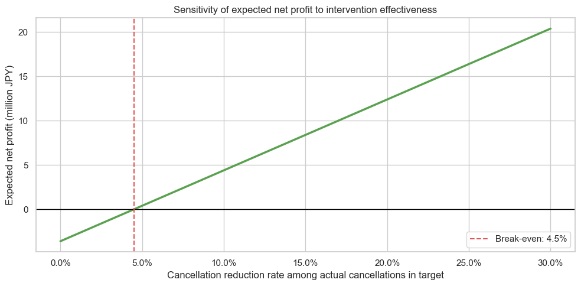

# Hotel Booking Cancellation Analysis

ホテル予約データを使い、キャンセル傾向の把握から予測モデル、SHAPによる解釈、施策と費用対効果の試算までを行った分析プロジェクトです。

単に精度の高いモデルを作るのではなく、**予約登録直後に利用できる情報だけで予測し、キャンセルの見逃しを減らしながら、ホテルが実行できる対応へつなげること**を目的としました。

## 1. プロジェクト概要

ホテルの予約キャンセルは、客室在庫や売上計画に影響します。本プロジェクトでは、次の問いを設定しました。

- どのような予約でキャンセル率が高いか
- 予約登録直後の情報からキャンセルリスクを予測できるか
- 予測結果を、確認メールや予約内容の再確認などの施策にどう活用できるか

分析は、SQL集計、PythonによるEDA、Random Forest、閾値調整、SHAP、施策シミュレーションの順に進めています。

### 主な結果

| 項目 | 結果 |
|---|---:|
| 全体キャンセル率 | 37.0% |
| Lead Time 61日以上のキャンセル率 | 48.4% |
| `market_segment = Groups`のキャンセル率 | 61.1% |
| Final Test ROC-AUC | 0.8622 |
| Final Test Recall（閾値0.30） | 0.8935 |
| Final Test Precision（閾値0.30） | 0.5548 |
| 高リスク対象件数 | 12,022件（Final Testの50.7%） |

## 2. 使用データ

- データセット：Hotel Booking Demand
- 取得先：[Kaggle - Hotel booking demand](https://www.kaggle.com/datasets/jessemostipak/hotel-booking-demand)
- 原論文：[António, Almeida, and Nunes (2019), Hotel booking demand datasets](https://doi.org/10.1016/j.dib.2018.11.126)
- 件数：119,390予約
- 列数：32列（ホテル種別を含む）
- 目的変数：`is_canceled`（1：キャンセル、0：非キャンセル）
- 期間：2015年7月〜2017年8月に到着予定の予約

主な変数は、`lead_time`、宿泊日数、予約経路、顧客タイプ、国、旅行代理店、過去のキャンセル回数などです。原論文はCC BY 4.0で公開されていますが、Kaggle上の配布条件との混同を避けるため、本リポジトリにはCSVを含めません。

## 3. 使用技術

- Python 3.13
- pandas / NumPy
- Matplotlib / Seaborn
- scikit-learn
- SHAP
- PostgreSQL 16 / SQL
- Docker Compose
- JupyterLab

## 4. 分析の流れ

| 順序 | Notebook / SQL | 内容 |
|---:|---|---|
| 1 | [`sql/`](sql/) | PostgreSQLで全体・Lead Time・市場セグメント・国別集計 |
| 2 | [`01_EDA.ipynb`](notebooks/01_EDA.ipynb) | キャンセル傾向の可視化 |
| 3 | [`02_Cancellation_Prediction.ipynb`](notebooks/02_Cancellation_Prediction.ipynb) | データリーク対策、時系列分割、モデル比較、閾値調整、Final Test |
| 4 | [`03_SHAP_Analysis.ipynb`](notebooks/03_SHAP_Analysis.ipynb) | 予測根拠と特徴量重要度の確認 |
| 5 | [`04_Business_Recommendations.ipynb`](notebooks/04_Business_Recommendations.ipynb) | 施策提案、対象者分析、費用対効果、A/Bテスト案 |

## 5. 主な分析結果

### Lead Timeが長い予約

Lead Time 61日以上は63,714件で、キャンセル率は48.4%でした。全キャンセルの69.8%を含むため、自動リマインドの対象候補としました。ただし、Lead Timeがキャンセルを引き起こすと証明したものではありません。


### 市場セグメント

`Groups`は19,811件、キャンセル率61.1%で、全体平均37.0%を上回りました。`Groups`は市場セグメント名であり、実際の人数や団体規模を直接表すとは限らない点に注意しています。


### SHAPによるモデル解釈

元特徴量単位では、`country`、`agent`、`customer_type`、`market_segment`、`lead_time`の順に予測への寄与が大きくなりました。SHAP値はモデルの予測根拠であり、キャンセルの原因を示すものではありません。また、国や代理店だけを理由に不利益な対応をしないことを施策上の注意点としています。


## 6. 機械学習モデル

### 予測時点とデータリーク対策

予測時点を「予約登録直後」としました。以下は予約後に確定する、または登録時点で利用可能か確認できないため除外しています。

- `reservation_status`
- `reservation_status_date`
- `assigned_room_type`
- `booking_changes`
- `days_in_waiting_list`
- `deposit_type`
- `adr`
- `total_of_special_requests`
- `company`

前処理は`Pipeline`と`ColumnTransformer`にまとめ、欠損値補完、上位カテゴリの選定、One-Hot Encodingを学習データ内で完結させました。

### 分割方法

到着予定日から`lead_time`を引いた推定予約日を使い、時系列順にTrain 60%・Validation 20%・Final Test 20%へ分割しました。予約IDがないため完全一致行は削除せず、同じ条件の重複グループが分割をまたがないことを確認しています。

### モデル比較

| Validationモデル | ROC-AUC | F1-score |
|---|---:|---:|
| Random Forest（country追加前） | 0.7930 | 0.6098 |
| country上位17か国 | 0.8600 | 0.6303 |
| country + agent上位10社 | 0.8804 | 0.6910 |

agent上位20社はROC-AUC 0.8810でしたが、上位10社との差は0.001未満でした。カテゴリ数が少なく、Validation F1-scoreが高い上位10社モデルを採用しました。

### 最終設定

```python
RandomForestClassifier(
    n_estimators=200,
    max_depth=18,
    min_samples_leaf=4,
    min_samples_split=8,
    random_state=42,
    n_jobs=-1,
)
```

ValidationでF1-scoreが最大となった0.30を判定閾値として選び、方針確定後にTrain＋Validationで再学習しました。Final Testはモデルや閾値の選択には使用していません。

| Final Test指標 | 値 |
|---|---:|
| Accuracy | 0.7407 |
| Precision | 0.5548 |
| Recall | 0.8935 |
| F1-score | 0.6846 |
| ROC-AUC | 0.8622 |
| PR-AUC | 0.7362 |


閾値0.30ではキャンセルの見逃しを減らせる一方、非キャンセル予約への対応も増えます。そのため、低コストな自動対応と、予測確率上位への個別対応を分ける方針としました。

## 7. ビジネス改善施策

1. **長期予約への自動フォロー**  
   Lead Time 61日以上を対象例とし、予約確認メールや宿泊前リマインドを送ります。

2. **Groups予約の内容確認**  
   人数、部屋数、日程、支払条件、キャンセル期限を段階的に確認します。

3. **モデルによる高リスク予約の優先対応**  
   閾値0.30以上の12,022件を自動対応の対象とし、電話など負荷の高い対応は確率上位層へ絞ります。

### 費用対効果の試算

施策コスト300円、キャンセル防止1件あたりの追加利益12,000円という仮定では、損益分岐となるキャンセル削減率は約4.5%でした。削減率5%の場合の差引利益は395,400円です。これらは実績ではなく、実際のコスト・限界利益・再販売率に置き換えるためのシミュレーションです。



施策効果は、確定済みモデルで対象を抽出したうえでControl群とTreatment群へ無作為割付するA/Bテストで検証する計画です。

## 8. 考察と今後の課題

- 予約IDがなく、完全一致行を同一予約と断定できない
- 予約日は到着日とLead Timeから近似している
- SHAPやセグメント別キャンセル率は因果効果を示さない
- Final TestでもTrainとの性能差があり、将来期間での監視が必要
- 予測確率の校正、ホテル別・時期別の性能、公平性の確認が必要
- 施策の効果と費用はA/Bテストで検証する必要がある

## 9. ディレクトリ構成

```text
.
├── README.md
├── requirements.txt
├── .gitignore
├── data/                  # CSVはGit管理対象外
├── docker/                # PostgreSQL環境
├── images/                # README掲載画像
├── notebooks/             # 01〜04の完成版Notebook
├── sql/                   # テーブル作成・読込・EDA集計
└── src/                   # 図の出力・公開前検証スクリプト
```

## 10. 実行方法

### データの準備

Kaggleから`hotel_bookings.csv`を取得し、`data/hotel_bookings.csv`へ配置します。CSVは`.gitignore`で除外されています。

### Python環境

```bash
python -m venv .venv
# Windows: .venv\Scripts\activate
# macOS/Linux: source .venv/bin/activate
pip install -r requirements.txt
jupyter lab
```

Notebookは`01_EDA.ipynb`から番号順に実行します。それぞれ単独でも実行できるよう、必要な読み込みと前処理を含めています。

README画像の再出力と公開前検証：

```bash
python src/export_readme_figures.py
python src/validate_project.py
```

### PostgreSQL / Docker

```bash
# PowerShell
Copy-Item docker/.env.example docker/.env

# macOS/Linux
# cp docker/.env.example docker/.env

# docker/.envのパスワードを変更してから起動する
docker compose --env-file docker/.env -f docker/docker-compose.yml up -d
docker exec hotel-booking-postgres psql -U hotel_user -d hotel_booking -f /sql/00_create_table.sql
docker exec hotel-booking-postgres psql -U hotel_user -d hotel_booking -f /sql/01_load_data.sql
docker exec hotel-booking-postgres psql -U hotel_user -d hotel_booking -f /sql/02_eda_queries.sql
```

ポート`5434`が他のPostgreSQLで使用中の場合は、`docker/.env`の`POSTGRES_PORT`を未使用のポートへ変更してください。

詳細は[`sql/README.md`](sql/README.md)を参照してください。

